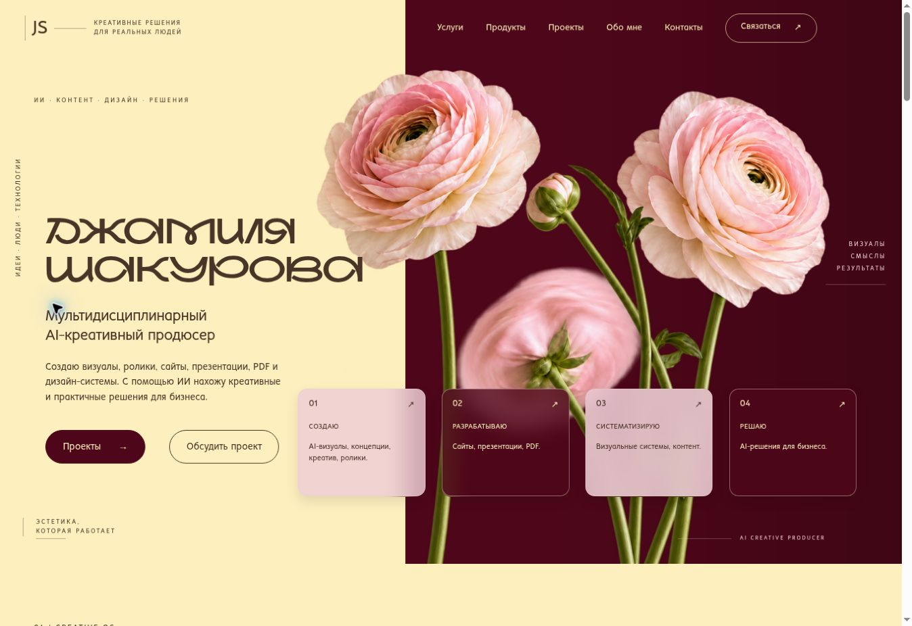
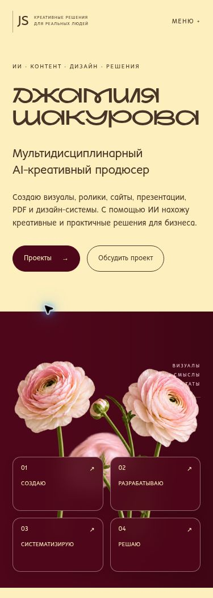
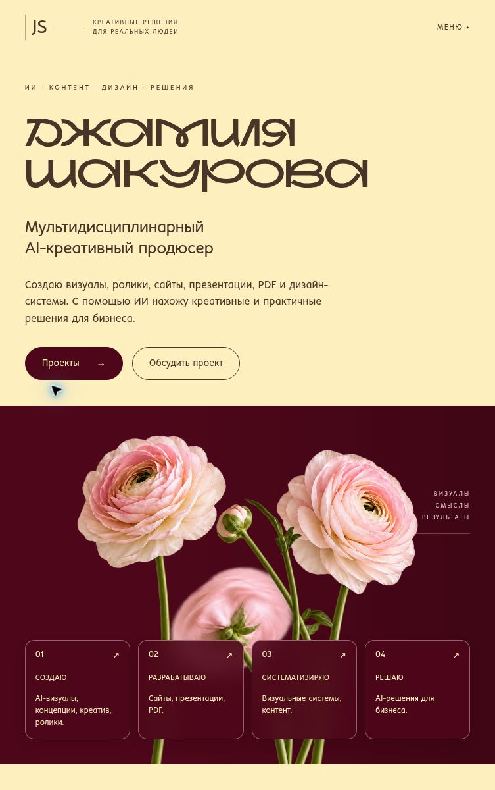

# Redesign: business card

## Реализация

Главная страница заменена на девять последовательных блоков: Header, Hero, Creative OS, продукты, проекты, процесс, About, контакты, Footer. UI разбит на отдельные компоненты без изменения инфраструктуры.

Основной референс: Figma `cI7s7Mh4v6VrILNluBeNnS`, Hero `5:2` (1586 × 992). Полный desktop `23:2`, mobile `11:3`. Граница Butter/Burgundy расположена на 44.95% ширины. Размер и позиция botanical композиции масштабируются от исходного Hero. На tablet/mobile композиция перестраивается вертикально; на laptop карточки становятся 2 × 2.

Настоящий прозрачный PNG ранункулюсов экспортирован из узла `80:33`, с сохранением исходного размытого цветка и стеблей. Имя первоначально экспортировано контурным SVG из `50:2` как референс. После получения шрифтов h1 переведен на живой текст NauryzRedKeds 700, с сохранением двух строк и масштабирования композиции. Тонкие направляющие экспортированы из Figma. В коде нет временных URL Figma или декоративных замен цветов.

Реальные материалы автора использованы для трех работ: Warm Botanical Vanity Still Life, Elegant seashell candle on soft backdrop, иллюстрация персонажа из 23871.png. Изображения сохранены локальными WebP. Названия описывают визуальные работы; клиентские результаты и заказы не выдуманы.

Конструктор/Диагностика — одна карточка и один внешний адрес. Закрытая стратегия содержит только название, PRIVATE и «Доступ по запросу». Приватная реализация Карманного дизайнера не перенесена; публичный CTA ведет к запросу доступа в Telegram.

## Проверки

- Зависимости установлены; локальный Vite/Vinext preview запущен и проверен в Chrome.
- `npm run lint`: PASS.
- `npm run build`: PASS, все пять этапов Vinext.
- `npm test`: PASS, 3/3. Существующий тест Worker обновлен под новое позиционирование и дополнен проверками продуктов, конфиденциальности и локальных изображений.
- Responsive проверен при ширинах iframe viewport 320, 390, 768, 1024, 1920 и desktop browser. `scrollWidth === clientWidth` во всех проверенных размерах (в desktop Chrome стандартный scrollbar занимает 15px).
- Desktop и mobile визуально сопоставлены с Figma: реальный botanical asset, разделение цветов, оригинальная типографика имени, editorial-подписи и четыре glass-карточки сохранены. Кадрирование свечи исправлено после визуальной проверки.
- Overlay: проверены четыре состояния, переключение Tab + Space, начальный фокус, Escape, ×, backdrop, возврат фокуса. На мобильном сохранена позиция прокрутки 351px после закрытия. Native modal делает фон недоступным для взаимодействия.
- Мобильное меню открывается и закрывается по Escape. Все внутренние якоря существуют; локальные изображения проектов загружаются при прокрутке.
- Контраст: основной Mocha/Butter 10.08:1, Mocha/Powder 7.91:1, Butter/Burgundy 13.34:1; мелкий текст использует эти пары. Olive используется для крупного декоративного номера и focus outline. Glass-панели затемнены/осветлены для читаемости текста.
- `prefers-reduced-motion`: проверены CSS и обработчики. Отключаются reveal, overlay animations, transitions, smooth scroll и parallax; закрытие происходит сразу. Переключение системной настройки в этом браузере не эмулировалось.
- Диагностика: HTTPS запрос вернул HTTP 200. Открытие в облачном Chrome зависло и завершилось тайм-аутом; сценарий внутри продукта не подтвержден.
- Instagram/Telegram: адреса проверены на соответствие заданию; инструменты чтения не смогли подтвердить страницы. Email — корректный mailto; сообщение не отправлялось.
- Дополнительный `npx tsc --noEmit` обнаружил прежние ошибки в неизмененном `worker/index.ts`: отсутствуют глобальные типы Fetcher и D1Database. Новые UI-компоненты не выдали ошибок. Vinext build и Worker tests проходят.

## Сохранено

`worker/index.ts`, `wrangler.jsonc`, `.github/workflows/deploy.yml`, `vite.config.ts`, `next.config.ts`, `build/`, `scripts/`, hosting manifest, favicon, Next/React/Vinext/Vite/Wrangler версии, команды запуска/сборки/deploy. Worker image endpoint и ASSETS binding не изменены. Никаких merge, workflow dispatch или production deployment не выполнено.

## Шрифты и оставшиеся пункты

1. Закрыто: автор предоставил NauryzRedKeds Bold (700), no_name_37 Regular (400), no_name_37 Light (350). Внутренние имена и веса проверены; шрифты подключены локально через @font-face. Arial удален из брендовых токенов. Синтетические начертания отключены. Метаданные — в `public/fonts/README.md`.
2. Для Карманного дизайнера не подтвержден отдельный публичный URL; до его получения CTA остается запросом доступа в Telegram.
3. Изолированный постоянный preview deployment не настроен. Production и существующий размещенный Site не изменялись. Локальный preview использован только для проверки; скриншоты сохранены в PR.

## Повторная проверка после подключения шрифтов

NauryzRedKeds 700, no_name_37 400/350 проверены по name/OS/2 таблицам и подключены локально. Hero стал живым текстом. На 320px скорректированы размеры заголовков продуктов, на tablet/laptop — масштаб имени. Переполнение страницы и h1/h2/h3 отсутствует при повторной проверке 320/390/768/1024px и desktop. Скриншоты обновлены с оригинальными шрифтами.

## Скриншоты

## Измененные файлы

- `app/page.tsx`, `app/layout.tsx`, `app/globals.css`.
- `components/Header.tsx`, `Hero.tsx`, `CreativeOS.tsx`, `ServiceCards.tsx`, `ServiceOverlay.tsx`, `ServiceProvider.tsx`, `Products.tsx`, `Projects.tsx`, `Process.tsx`, `About.tsx`, `Contact.tsx`, `Footer.tsx`, `Reveal.tsx`.
- `data/business-card.ts`.
- `public/images/ranunculus.png`, `name-nauryz.svg`, `figma/guide-{0,1,3,4,5,6}.svg`, `projects/{botanical-beauty,seashell-candle,samir}.webp`.
- `public/fonts/README.md`, `public/fonts/NAURYZREDKEDS.ttf`, `public/fonts/no_name_37_Regular.otf`, `public/fonts/no_name_37_Light.otf`, `tests/rendered-html.test.mjs`, `package-lock.json`, `.gitignore`, `README.md`.
- `docs/redesign-report.md`, `docs/screenshots/{desktop,mobile,tablet}.jpg`.
